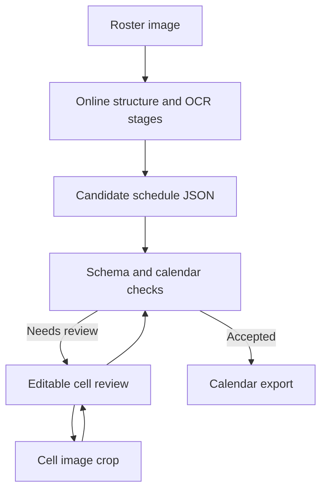

# Shiftfolio / Shiftnama: design record

## Purpose

Convert roster images to an editable schedule and calendar export in Persian and English.

## Elements

| Element | Documentation boundary |
| :-- | :-- |
| Image upload | Included in the stated project scope. Implementation details need the corresponding source or design file. |
| Online extraction | Included in the stated project scope. Implementation details need the corresponding source or design file. |
| Schedule validation | Included in the stated project scope. Implementation details need the corresponding source or design file. |
| Editable review | Included in the stated project scope. Implementation details need the corresponding source or design file. |
| Calendar export | Included in the stated project scope. Implementation details need the corresponding source or design file. |

## Technical stack

- Cloudflare Workers
- D1
- Online OCR and AI
- Calendar export
- PWA

## Boundaries

The current design preference is online OCR and AI processing. Older offline research packages are separate experiments. Roster images can contain personal data. Only synthetic or fully redacted samples belong in a public demo. Year, month, day count and person rows need validation before calendar export.

## Decisions to recover

Record each design decision with its problem, selected option, rejected options and supporting artifact. Keep the original model or source revision with the record.

## Planned online extraction design

The following is the requested pipeline design. Its complete implementation has not been verified from the current source.

Preserve empty cells. Check Jalali year, month, month length, people and per-person day counts. Use uncertain-cell review to correct the extraction before export. Table lines in a preview must remain thin enough to leave text visible.

The requested architecture uses online services for recognition. Historical offline model archives do not establish the current deployed pipeline. Do not add real hospital rosters to a public demo.
